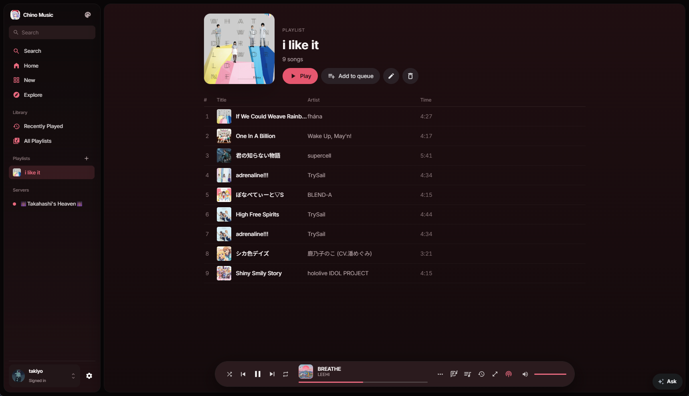
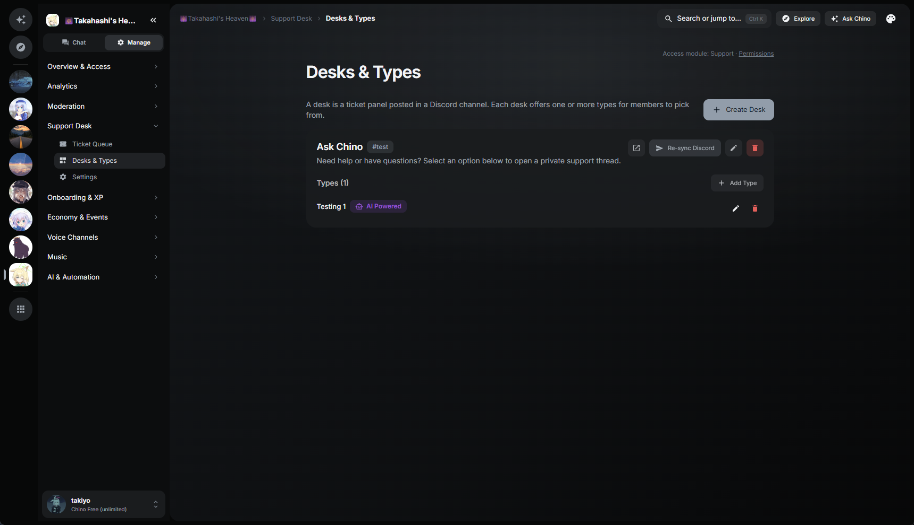
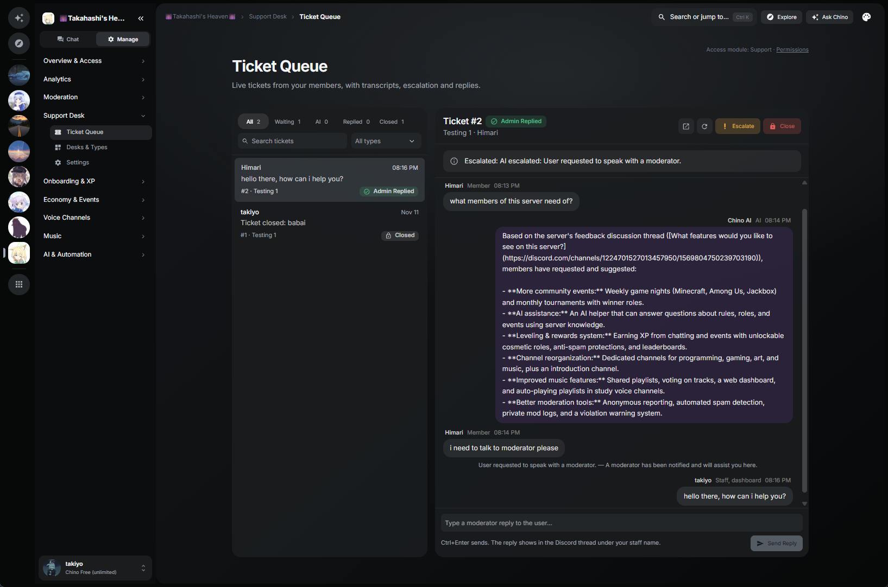
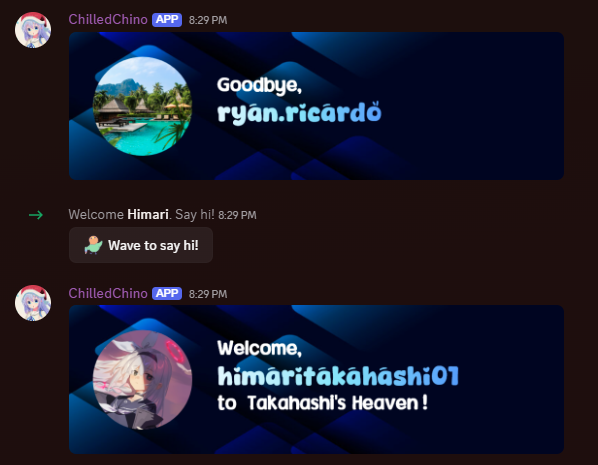

# Master Feature List

Every live feature in ChilledChino, ranked from most important to least important. Click any feature for its guide, or check [Commands](/docs/reference/commands), [Permissions](/docs/reference/permissions), and [Pricing](/docs/reference/pricing).

## 1. AI

| Feature | What it does | Discord | Web |
|---|---|---|---|
| [**AI Chat**](/docs/ai/overview) | Conversational assistant with tool calling and optional image input | [`/ask`](/docs/reference/commands) | `/chat`, `/dashboard/<id>/chat` |
| [**Server Knowledge**](/docs/ai/knowledge) | Grounded Q&A from approved text, URLs, channels, pins, and forums | [`/ask-server`](/docs/reference/commands) | `/dashboard/<id>/knowledge`, `/chat/<slug>` |
| [**Channel Catch Up**](/docs/ai/overview) | Ephemeral summary of missed channel messages with citations | [`/catchup`](/docs/reference/commands) | `/dashboard/<id>/chat` |
| [**AI Server Setup**](/docs/ai/overview) | Proposes channel and role plans for admin approval | [`/setup`](/docs/reference/commands) | `/dashboard/<id>/chat` |
| [**AI Automation Draft**](/docs/server/engagement/automation) | Drafts event-condition-action rules from plain English | [`/automate`](/docs/reference/commands) (`draft`) | `/dashboard/<id>/automation` |
| [**Guest & Public Links**](/docs/ai/access-guests) | Unguessable public Q&A links protected by Turnstile | - | `/chat`, `/chat/<slug>` |
| [**Docs Assistant**](/docs/ai/overview) | Built-in `/docs` helper that reads docs and guides you to settings | - | `/docs` |

## 2. Music

| Feature | What it does | Discord | Web | Preview |
|---|---|---|---|---|
| [**Music & Web DJ**](/docs/music/web-dj) | Play, queue, seek, jump, loop, shuffle, volume, DJ role, live web player | [`/play`](/docs/reference/commands), [`/music`](/docs/reference/commands) | `/music`, `/dashboard/<id>/music/settings` |  |
| [**Dedicated Player Channel**](/docs/music/playback) | Always-on player card; typed requests auto-queue and auto-clean | [`/music`](/docs/reference/commands) (`player`) | `/dashboard/<id>/music/settings` |  |
| [**Synced Lyrics**](/docs/music/advanced) | Live syllable/line-synced lyrics | [`/lyrics`](/docs/reference/commands) | `/music` |  |
| [**Autoplay & Crossfade**](/docs/music/advanced) | AI-curated or Spotify Radio queue refills + 1–12s transitions | [`/autoplay`](/docs/reference/commands), [`/crossfade`](/docs/reference/commands) | `/music` | - |
| [**Personal Playlists**](/docs/music/web-dj) | Save queues, create/edit playlists, play to any active server | [`/music`](/docs/reference/commands) (`playlists`) | `/music/playlists` | - |
| [**Audio Effects**](/docs/music/advanced) | Tone, Spatial/8D, Nightcore/Pitch, Modulation, Distortion filters | [`/music`](/docs/reference/commands) (`effects`) | - | - |

## 3. Moderation

| Feature | What it does | Discord | Web | Preview |
|---|---|---|---|---|
| [**AutoMod Engine**](/docs/server/moderation/automod) | 14 rule types, 4 presets, 7 actions, 41 ad types, dry-run tester | [`/mod`](/docs/reference/commands) (`automod`) | `/dashboard/<id>/automod` |  |
| [**Mod Commands & Hub**](/docs/server/moderation/commands) | Ban, unban, kick, purge (up to 1000), slowmode, warn, timeout, AFKs | [`/mod`](/docs/reference/commands), [`/ban`](/docs/reference/commands), [`/kick`](/docs/reference/commands), [`/purge`](/docs/reference/commands), [`/warn`](/docs/reference/commands) | `/dashboard/<id>/moderation`, `/dashboard/<id>/warnings` |  |
| [**Member Reports**](/docs/server/moderation/reports-logs) | Right-click message/user reporting into a staff review queue | Right-click *Report* | `/dashboard/<id>/reports` |  |
| [**Mod & Admin Logs**](/docs/server/moderation/reports-logs) | Event audit logs and moderator action logs | [`/mod`](/docs/reference/commands) (`adminlogs`, `eventlogs`) | `/dashboard/<id>/modlogs` | - |

## 4. Support AI & Desks

| Feature | What it does | Discord | Web | Preview |
|---|---|---|---|---|
| [**Multi-Desk Support Panels**](/docs/server/support/desks) | Publish button/select ticket panels with custom types in private threads | [`/configure`](/docs/reference/commands) (`support`) | `/dashboard/<id>/support/desks` |  |
| [**AI Triage & Handoff**](/docs/server/support/triage) | Answers from server knowledge, escalates to staff on request or failure | Private ticket threads | `/dashboard/<id>/support/queue` |  |
| [**Ticket Timeouts & Retention**](/docs/server/support/triage) | Auto-close inactive tickets and purge transcripts after N days | - | `/dashboard/<id>/support/settings` | - |

## 5. Onboarding & Roles

| Feature | What it does | Discord | Web | Preview |
|---|---|---|---|---|
| [**Welcome & Farewell**](/docs/server/onboarding/greetings) | Join/leave messages with placeholders and custom images | [`/configure`](/docs/reference/commands) (`welcome`, `farewell`) | `/dashboard/<id>/onboarding` |  |
| [**Canvas Card Studio**](/docs/server/onboarding/canvas) | 1000×300 custom cards (avatars, fonts, gradients, progress bars) | - | `/dashboard/<id>/canvas` |  |
| [**Autoroles & Role Menus**](/docs/server/onboarding/roles) | Join roles + reaction/button self-role menus with hierarchy checks | [`/configure`](/docs/reference/commands) (`roles`, `joinroles`) | `/dashboard/<id>/roles` |  |

## 6. Community

| Feature | What it does | Discord | Web | Preview |
|---|---|---|---|---|
| [**Leveling & XP**](/docs/server/community/leveling) | XP tracking, multipliers, ignored roles/channels, level role rewards | [`/rank`](/docs/reference/commands), [`/leaderboard`](/docs/reference/commands) | `/dashboard/<id>/leveling` |  |
| [**Economy & Shop**](/docs/server/community/economy) | ChinoCoins, daily/work/pay/rob, role-bound shop items, inventories | [`/economy`](/docs/reference/commands), [`/daily`](/docs/reference/commands), [`/work`](/docs/reference/commands) | `/dashboard/<id>/economy`, `/shop` |  |
| [**Daily Quests**](/docs/server/community/economy) | Rotating server quests with automatic idempotent coin rewards | [`/quests`](/docs/reference/commands) | `/dashboard/<id>/quests` | - |
| [**Giveaways & Lucky Draw**](/docs/server/community/giveaways) | [Requirement-gated](/docs/server/community/giveaways-requirements) giveaways with Random, Manual, or [Lucky Draw](/docs/server/community/giveaways-lucky-draw) | [`/giveaway`](/docs/reference/commands) | `/dashboard/<id>/giveaway`, `/giveaway/<g>/<id>` | - |
| [**Birthdays**](/docs/server/community/birthdays-games) | Member birthday tracking, upcoming list, channel/role announcements | [`/birthday`](/docs/reference/commands) | `/dashboard/<id>/birthdays` | - |
| [**Mini-Games & AFK**](/docs/server/community/birthdays-games) | Multiplayer Quiz, TypeRacer (WPM), AFK status | [`/quiz`](/docs/reference/commands), [`/typeracer`](/docs/reference/commands), [`/afk`](/docs/reference/commands) | `/dashboard/<id>/community` | - |

## 7. Engagement & Voice

| Feature | What it does | Discord | Web |
|---|---|---|---|
| [**Managed Voice Rooms**](/docs/server/engagement/voice) | Join-to-Create temp voice channels with owner controls & blacklists | [`/voice`](/docs/reference/commands), [`/configure`](/docs/reference/commands) (`voice`) | `/dashboard/<id>/voice-channels` |
| [**Voice Recordings**](/docs/privacy/overview) | Record a voice meeting with a visible notice and opt-out, play it back per speaker for 7 days (pilot servers) | [`/record`](/docs/reference/commands) | `/dashboard/<id>/recordings` |
| [**Automation Workflows**](/docs/server/engagement/automation) | Event-condition-action rules with test simulator & revision diffs | [`/automate`](/docs/reference/commands) | `/dashboard/<id>/automation` |
| [**Analytics & Digests**](/docs/server/engagement/analytics) | Activity charts + scheduled reports with optional AI channel summaries | [`/analytics`](/docs/reference/commands) | `/dashboard/<id>/analytics` |
| [**Auto-Response**](/docs/server/engagement/tools) | Keyword triggers with channel/role blacklists | [`/configure`](/docs/reference/commands) (`autoresponse`) | `/dashboard/<id>/auto-response` |
| [**Channel Counters**](/docs/server/engagement/tools) | 14 live stat counter types + per-role counters | [`/configure`](/docs/reference/commands) (`channelstats`) | `/dashboard/<id>/counters` |
| [**Starboard**](/docs/server/engagement/tools) | Highlight popular messages into a starboard channel | [`/configure`](/docs/reference/commands) (`starboard`) | `/dashboard/<id>/engagement` |
| [**Announcements**](/docs/server/engagement/tools) | Schedule future messages to server channels | [`/configure`](/docs/reference/commands) (`announcements`) | `/dashboard/<id>/announcements` |

## 8. Personal

| Feature | What it does | Discord | Web |
|---|---|---|---|
| [**Right-Click AI**](/docs/personal/context-actions) | Ask Chino, Explain, Summarize, Translate on any message | Right-click *Apps* | - |
| [**Reminders**](/docs/personal/reminders) | Natural-language reminders, recurrences, snooze, link-only context menu | [`/remind`](/docs/reference/commands), Right-click *Remind me* | `/me/reminders` |
| [**Account & Sessions**](/docs/personal/account) | Language, timezone, About Me, AI opt-out, active web sessions | [`/account`](/docs/reference/commands) | `/me`, `/me/settings`, `/me/security` |
| [**Utilities & Fun**](/docs/personal/utilities) | Anime/animal images, Urban Dictionary, IP, movies, translate, server info | [`/anime`](/docs/reference/commands), [`/movie`](/docs/reference/commands), [`/server`](/docs/reference/commands) | - |

## 9. Permissions, Plans & Support

| Feature | What it does | Discord | Web |
|---|---|---|---|
| [**3-Level RBAC**](/docs/admin/permissions) | `None` / `Read` / `Write` per role or member across [delegable modules](/docs/reference/permissions) | Enforced in panels | `/dashboard/<id>/permissions` |
| [**User-Owned Premium**](/docs/admin/plans) | 5 tiers (Free to Luminary) shared to servers ([up to date data](/docs/reference/pricing)) | [`/account`](/docs/reference/commands) (`premium`) | `/premium`, `/user/subscription` |
| [**Backup & Revisions**](/docs/admin/backup-revisions) | Export/import server settings JSON + draft/publish/rollback history | - | `/dashboard/<id>/insights` |
| [**Tickets & Feedback**](/docs/support/tickets) | Submit bugs/feedback and reply via web or Discord DMs | [`/report`](/docs/reference/commands), [`/tickets`](/docs/reference/commands) | `/feedback`, `/tickets` |

## 10. Chino Together

| Feature | What it does | Discord | Web |
|---|---|---|---|
| [**Plans & Scheduling**](/docs/together/plans) | Game/study/watch plans, invites, 30-min availability grid, overlap finder | [`/together`](/docs/reference/commands) | `/together` |
| [**Voting & Voice Handoff**](/docs/together/sessions) | Instant-Runoff ranked voting, RSVPs, launch voice room in a server | [`/together`](/docs/reference/commands) | `/together/<id>` |
