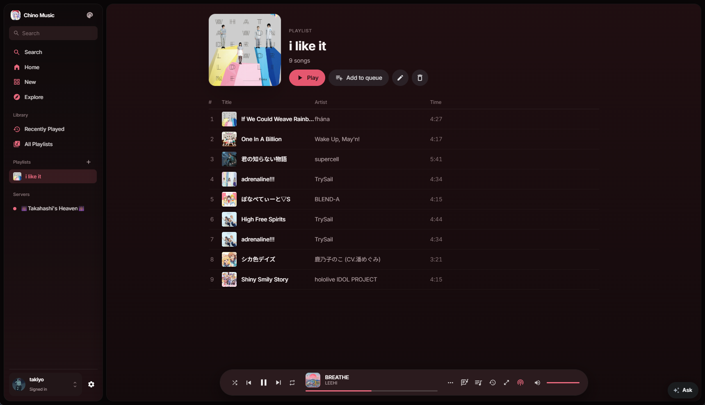

# Playing Music in Discord

Chino plays audio from search queries, Spotify links/playlists/albums (up to 1,000 tracks), and direct audio URLs.

## Essential Commands

| Action | Command | Notes |
|---|---|---|
| Play / Enqueue | [`/play`](/docs/reference/commands) | Supports instant autocomplete and chart quick-picks |
| View Queue / Now Playing | [`/queue`](/docs/reference/commands), [`/nowplaying`](/docs/reference/commands) | Shows current track, progress bar, and metadata |
| Playback Controls | [`/pause`](/docs/reference/commands), [`/skip`](/docs/reference/commands), [`/stop`](/docs/reference/commands), [`/leave`](/docs/reference/commands) | `Stop` cancels pending requests, clears queue, keeps voice |
| Queue & Time | [`/jump`](/docs/reference/commands), [`/seek`](/docs/reference/commands), [`/loop`](/docs/reference/commands), [`/shuffle`](/docs/reference/commands), [`/volume`](/docs/reference/commands) | Loop modes: `off`, `track`, `queue`; Volume: `0–150` |
| All-in-One Panel | [`/music`](/docs/reference/commands) | Tabs: `control`, `playlists`, `effects`, `player` |

## Dedicated Player Channel

Set up in [`/music`](/docs/reference/commands) (`player`) or **Dashboard → Music → Settings** (`/dashboard/<id>/music/settings`):

- **Create or Attach:** Let Chino create a dedicated player channel or attach to an existing text channel.
- **Typed Requests:** When enabled, any message typed in the player channel is treated as a song search/URL and auto-deleted in batches.
- **Self-Check & Repair:** Dashboard shows channel health (`ready`, `missing_panel`, `missing_channel`, `missing_permissions`) with a one-click **Repair** button.

## DJ Role & Safeguards

- **Voice Co-Presence:** Playback mutations require you to be in the **same voice channel** as Chino. Read-only views (`/queue`, `/nowplaying`, `/lyrics`) do not.
- **DJ Role:** Restrict playback controls to a specific role or leave open to `@everyone`.
- **Cooldowns:** Configurable per-user (`1–60s`), per-guild (`1–10s`), control (`1–10s`), and channel slowmode (`0–21,600s`).
- **Abuse Tripwire:** **5 violations within 30 seconds** triggers a temporary **1-minute** playback block (escalates to **5 minutes** if repeated within 10 minutes). Viewing the queue stays open.
