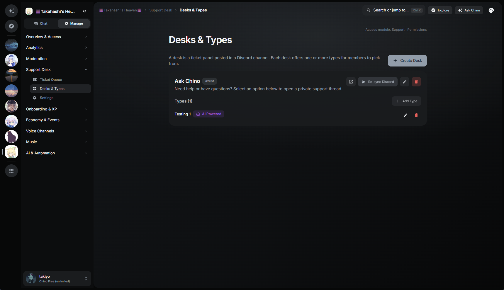

# Support Desks & Ticket Types

Support Desk lets members open private support threads from a Discord panel, with optional AI triage before handing off to staff.

## Setting Up a Desk

Configure desks in [`/configure`](/docs/reference/commands) (`support`) or **Dashboard → Support Desk → Desks & Types** (`/dashboard/<id>/support/desks`):

1. **Create a Desk:** Pick the host channel and default staff notification channel.
2. **Add Ticket Types:** Up to 5 buttons per row or 25 select menu options. Each type can set:
   - **Name & Description** (up to 50 / 200 chars) and **Emoji / Button Style**.
   - **Greeting Message** shown inside the new private thread.
   - **AI Triage Toggle & Instructions** (optional per-type AI behavior).
   - **Notification Override:** `inherit` from desk/server, `custom` channel/roles, or `off`.
3. **Publish Panel:** Post the interactive panel to the host channel from [`/configure`](/docs/reference/commands) or the dashboard.

## Private Threads

When a member opens a ticket, Chino creates a private Discord thread named `` `{type} · {username} ({last4digits})` `` and displays a privacy notice: only the member, Chino, and moderators who can manage threads can view it.
