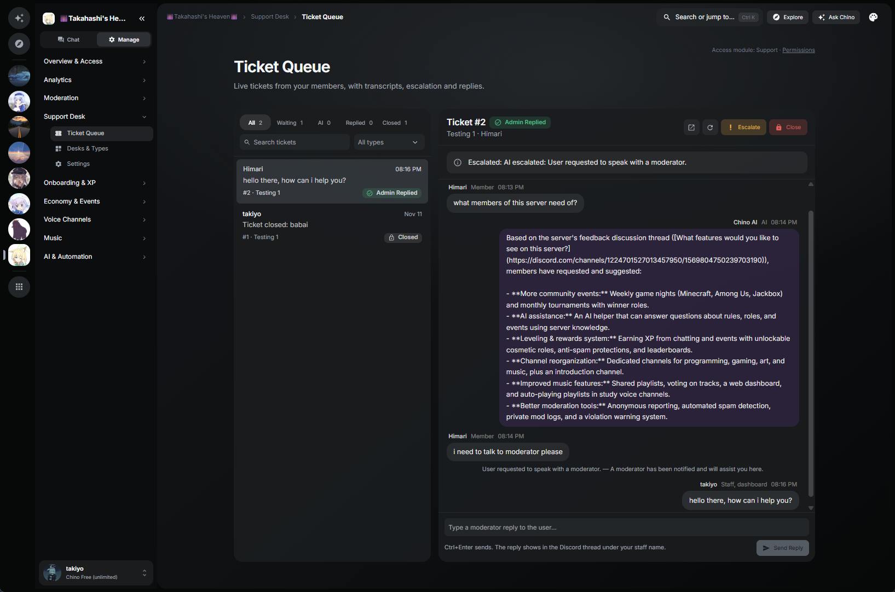

# AI Triage, Escalation & Queue

## Ticket Lifecycle

| Status | Meaning |
|---|---|
| **Active (AI)** | Chino AI is answering using approved [Server Knowledge](/docs/ai/knowledge) and thread context |
| **Waiting for staff** | Escalated to staff (user asked for a human, AI couldn't answer, or AI is unavailable) |
| **Staff replied** | A staff member replied from Discord or the web queue |
| **Closed** | Ticket closed by user, staff, AI, or inactivity timeout |

## Automatic Handoff

If server AI is disabled, the user opted out of AI, AI quota is used up, or access is denied, the ticket switches straight to **Waiting for staff**, notifies the member, and pings the configured staff channel.

## Live Queue & Settings

- **Ticket Queue (`/dashboard/<id>/support/queue`):** Filter by status, read live transcripts, reply directly from the web, or close/reopen tickets.
- **Settings (`/dashboard/<id>/support/settings`):**
  - **Open Tickets Cap:** Open tickets allowed per user (`0` = unlimited), up to the maximum in [Support desks](/docs/reference/pricing#support-desks).
  - **Inactivity Timeout:** Within the range in [Support desks](/docs/reference/pricing#support-desks), or `0` to disable auto-close.
  - **Reopen Ping Cooldown:** Prevents notification spam when tickets are reopened.
  - **Transcript Retention:** Closed transcripts are kept for a default period (configurable per server, see [Support desks](/docs/reference/pricing#support-desks)) before automatic purge.

